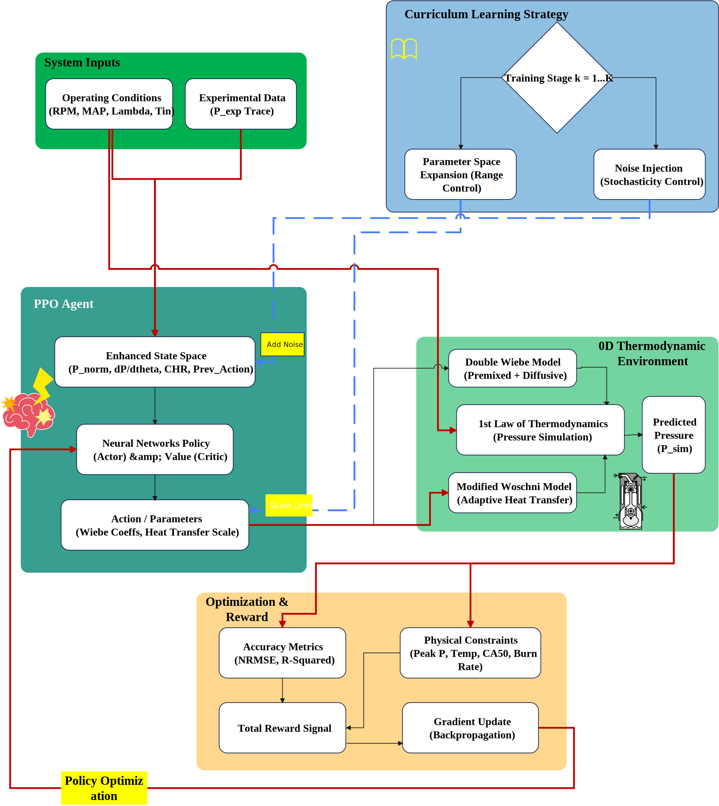

# wiebe-curriculum-rl

Physics-informed reinforcement learning for calibrating **double Wiebe
combustion models** (nine burn-law and heat-transfer parameters) from
measured in-cylinder pressure traces.

[](https://github.com/mehrdadraeesi1-svg/wiebe-curriculum-rl/actions/workflows/ci.yml)
[%20101986-blue)](https://doi.org/10.1016/j.ecmx.2026.101986)
[](LICENSE)

The package contains a Numba-compiled 0-D thermodynamic solver, a Gymnasium
environment whose reward combines pressure-trace accuracy with
physical-feasibility penalties, PPO/A2C training with a staged curriculum,
GA and XGBoost baselines, split-generation and compensation-effect
diagnostics, a latency profiler, a pretrained policy and a test suite.



> **Upgrading from v0.x / reproducing Ref. [1]?** Read
> [CHANGELOG.md](CHANGELOG.md). v1.0.0 fixes three issues of the
> pre-release code that affect how the published numbers should be read:
> the curriculum never advanced beyond stage 1 during training, evaluation
> normalised inputs with test-set statistics, and the old profiler
> substituted placeholder GA/XGBoost timings. The published numbers are
> still reproducible with `legacy` options; see
> [docs/REPRODUCIBILITY.md](docs/REPRODUCIBILITY.md).

## Installation

```bash
git clone https://github.com/mehrdadraeesi1-svg/wiebe-curriculum-rl.git
cd wiebe-curriculum-rl
pip install -e ".[dev]"          # Python 3.9-3.12, CPU is sufficient
pytest                           # ~1 min
```

## Quick start (no external data needed)

```bash
# 1. ten synthetic operating points with known parameters
python data/sample/generate_sample.py

# 2. calibrate them with the bundled pretrained policy
python scripts/calibrate_cases.py --cases data/sample/synthetic_isoline \
    --out results/calibration.csv --plot results/plots

# 3. same with the genetic-algorithm baseline
python scripts/calibrate_cases.py --cases data/sample/synthetic_isoline \
    --method ga --out results/calibration_ga.csv

# 4. measure latency and memory on this machine
python scripts/profile_inference.py --repetitions 3000 --ga-cases 3
```

Expected for step 2: success on 5 of 10 points (R² > 0.98 on the five
points from 110 to 190 kPa intake pressure; accuracy drops above 200 kPa
and the three points at 250–290 kPa fail clearly). The efficiency parameter
`a` is reported on its lower bound: `a`, `delta_theta` and `k` are exactly
degenerate in the double Wiebe law (docs/MODEL.md), so compare
calibrations through the burn law, not through these three values.

Python API:

```python
from src.calibrate import PolicyCalibrator
from src.utils.data_loader import load_cases

cal = PolicyCalibrator.from_pretrained("models/pretrained/ppo_speed_isoline_curriculum_seed2024.zip")
for r in cal.calibrate(load_cases("path/to/cases")):
    print(r["case_id"], r["params"], r["metrics"]["r2"], r["success"], r["params_at_bound"])
```

## Your own data

Input is one JSON file per operating point (geometry, speed, λ, intake
pressure and temperature, crank-angle-resolved pressure). The format and all
output columns are specified in [docs/DATA_FORMAT.md](docs/DATA_FORMAT.md).

The bundled policy was trained on **one** engine (499.4 cm³ single-cylinder
GDI, bore 83.0 mm, stroke 92.3 mm, CR 12.5, gasoline). For another engine,
train a new policy:

```bash
python scripts/make_splits.py --data-dir my_cases --output-dir splits
python scripts/train_on_split.py --config config/default_config.yaml \
    --data-dir my_cases --split-file splits/split_grid_stratified.json \
    --output-dir runs/my_engine/seed_42 --seed 42
python scripts/calibrate_cases.py --cases my_new_cases \
    --model runs/my_engine/seed_42/models/best/best_model.zip
```

300 000 steps take about 20 min on two CPU cores.

## Repository layout

```
src/
  utils/thermodynamics.py     0-D first-law solver, Woschni-type heat transfer (Numba)
  models/wiebe_functions.py   single / double Wiebe burn laws (Numba)
  environment/wiebe_env.py    Gymnasium environment: observation, action mapping, reward
  curriculum.py               curriculum schedule + CurriculumSyncCallback
  calibrate.py                PolicyCalibrator (inference API)
  baselines/ga.py             genetic-algorithm baseline
  utils/data_loader.py        JSON loader
  utils/data_splits.py        random / grid-stratified / isoline / extrapolation splits
scripts/
  calibrate_cases.py          calibrate cases (policy or GA) -> CSV/JSON/plots
  make_splits.py              generate the four partitions + distance diagnostics
  train_on_split.py           PPO/A2C training (train_ppo.py is a shortcut)
  evaluate_all_splits.py      benchmark all trained runs (Table 6 of Ref. [1])
  xgboost_baseline.py         XGBoost on GA pseudo-labels
  compensation_analysis.py    total-variation diagnostic along an isoline
  profile_inference.py        latency / memory profiler
models/pretrained/            PPO trained with the corrected curriculum (speed-isoline holdout) + sidecar
config/default_config.yaml    training configuration
tests/                        pytest suite (run by GitHub Actions)
docs/                         data format, model notes, reproducibility matrix
```

## Validation

`pytest` runs 40+ tests on every push (Linux, Windows, macOS; Python 3.9
to 3.12):

* **solver** – isentropic motored compression, exact discrete energy
  balance, released heat equals fuel energy, monotonic effect of heat
  transfer, ideal-gas consistency;
* **burn law** – closed-form values, monotonicity, weight limits, CA50;
* **environment** – spaces, action mapping inside the admissible box for
  every stage, frozen normalisation, curriculum stage switching, reward
  terms, and a round trip (true parameters reproduce the synthetic trace,
  R² > 0.999999);
* **curriculum** – regression test showing the v0.x stall and the fixed
  synchronisation;
* **pipeline** – pretrained-policy regression on the synthetic isoline, GA
  recovery, CLI end-to-end, training CLI smoke test, profiler.

## Results

Speed-isoline holdout of Ref. [1] (3000 rpm withheld, 59 test points):

| PPO, double Wiebe | R² | Success rate |
|---|---|---|
| Ref. [1] as published (v0.x: curriculum stalled in stage 1, test-set normalisation; 3 seeds) | 0.971 ± 0.004 | 91.5 % |
| same v0.x models, training-set normalisation (3 seeds) | 0.988 ± 0.002 | 100 % |
| v1.0.0, corrected curriculum to the full parameter box (3 seeds) | 0.972 ± 0.009 | 83.1 ± 18.3 % |
| **bundled policy** (v1.0.0 curriculum, seed 2024) | **0.980** | **100 %** |

The bundled seed was selected on the 120 validation cases (61.7 % success,
R² 0.952 there, against 60.0 % and 50.0 % for the other seeds), not on the
test points; the three-seed mean is the unbiased estimate.

Success = R² ≥ 0.95, NRMSE ≤ 5 %, peak pressure within 2–200 bar; peak
temperature and burn constraints were also met at every successful point.
All four partitions, the A2C and XGBoost comparisons and the latency
measurements are listed in [docs/REPRODUCIBILITY.md](docs/REPRODUCIBILITY.md);
retraining with the corrected curriculum (83 % success to the full
parameter box, against 51 % without a curriculum) in
[docs/CURRICULUM_RETRAINING.md](docs/CURRICULUM_RETRAINING.md).

## Limitations and operating envelope

* Validated on a single engine and fuel. Use the bundled policy only inside
  its training envelope (1500–4500 rpm, 100–300 kPa intake pressure,
  λ 0.94–2.07, intake temperature 316–320 K, the geometry above); the
  calibrator warns outside it. Other engines need retraining.
* Load extrapolation is weak: policies trained without the ≥ 270 kPa region
  reach 24 % strict success there (Ref. [1] models, v1.0.0 normalisation;
  0.9 % as published), and the bundled policy loses accuracy above about
  200 kPa on the synthetic isoline. Per-point optimisation with the GA is
  preferable there.
* `a`, `delta_theta` and `k` are not individually identifiable (exact
  degeneracy, docs/MODEL.md). The bundled policy places `a` on its lower
  bound; parameters on a bound are flagged in `params_at_bound`, and a flat
  trajectory of such a parameter is not regularisation.
* Policies trained with v0.x code act in the stage-1 box (α = 0.5); the
  bundled v1.0.0 policy acts in the full box.
* Latencies are measured on desktop CPUs. Microcontroller figures are
  CoreMark-scaled estimates; no ECU hardware has been profiled.

## Citation

Please cite both the software and the research article (see
[CITATION.cff](CITATION.cff)):

> M. Raeesi, M.H. Shojaeefard, Physics-informed curriculum learning for
> real-time calibration of double Wiebe combustion models: a deep
> reinforcement learning approach, Energy Convers. Manag. X 31 (2026)
> 101986. https://doi.org/10.1016/j.ecmx.2026.101986

The experimental dataset of the associated study comes from Yuan et al.,
Energy 313 (2024) 134074 (https://doi.org/10.1016/j.energy.2024.134074) and
is not redistributed here.

## License

MIT © 2026 Mehrdad Raeesi, Mohammad Hassan Shojaeefard — Iran University of
Science and Technology. Contact: mehrdadraeesi@gmail.com
